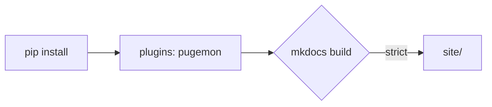

# Подключение

Тема ставится как пакет Python и включается плагином `pugemon`. Файлы темы в проект копировать
не нужно.

## За две строки

`requirements-docs.txt` проекта:

```text
mkdocs-material==9.7.7
pugemon-mkdocs @ git+https://github.com/pugemon/pugemon-mkdocs.git@v0.1.0
```

`mkdocs.yml`:

```yaml
theme:
  name: material
  language: ru

plugins:
  - search
  - pugemon
```

```console
$ pip install -r requirements-docs.txt
$ mkdocs serve
```

## Что делает плагин

- Добавляет файлы темы: стили `pugemon.css` и `mermaid.css`, пиксельный знак, фавикон и страницу 404.
  Каталог темы встаёт сразу после `custom_dir` проекта, поэтому свои шаблоны проекта
  по-прежнему главнее.
- Ставит стили темы в начало `extra_css`: свои стили проекта подключаются после них и могут
  что-то поправить.
- Задаёт схемы `pugemon-dark` и `pugemon-light`, шрифты IBM Plex Sans и IBM Plex Mono, знак
  и фавикон, но только если проект не указал своё. Своя `palette`, `font`, `logo` или `favicon`
  в `theme` всегда главнее.

## Настройки

```yaml
plugins:
  - pugemon:
      scheme: auto     # auto — по системе (без предпочтения — тёмная), dark или light — с какой начинать
      toggle: true     # переключатель схем в шапке
      fonts: true      # IBM Plex Sans / Mono, если шрифт не задан в theme.font
      logo: true       # знак и фавикон, если не заданы в theme
```

| Параметр | По умолчанию | Что делает |
| --- | --- | --- |
| `scheme` | `auto` | С какой схемы открывается сайт: `auto` — по настройке системы, `dark`, `light` |
| `toggle` | `true` | Переключатель тёмной и светлой схемы в шапке; `false` — одна схема |
| `fonts` | `true` | IBM Plex Sans и IBM Plex Mono из Google Fonts |
| `logo` | `true` | Пиксельный знак в шапке и фавикон |

## Рекомендуемые расширения Markdown

Тема перекрашивает всё, что дают эти расширения: примечания, вкладки, клавиши, выделение,
заголовки блоков кода, схемы mermaid.

```yaml
markdown_extensions:
  - admonition
  - attr_list
  - md_in_html
  - tables
  - toc:
      permalink: true
  - pymdownx.details
  - pymdownx.highlight:
      anchor_linenums: true
      line_spans: __span
      pygments_lang_class: true
  - pymdownx.inlinehilite
  - pymdownx.snippets
  - pymdownx.superfences:
      custom_fences:
        - name: mermaid
          class: mermaid
          format: !!python/name:pymdownx.superfences.fence_code_format
  - pymdownx.tabbed:
      alternate_style: true
  - pymdownx.keys
  - pymdownx.mark
```

## Метки статуса

```html
<span class="pg-tag pg-tag--ok">готово</span>
<span class="pg-tag pg-tag--wip">в работе</span>
<span class="pg-tag pg-tag--bad">заброшен</span>
```

<span class="pg-tag pg-tag--ok">готово</span>
<span class="pg-tag pg-tag--wip">в работе</span>
<span class="pg-tag pg-tag--bad">заброшен</span>

Для пиксель-арта на страницах добавьте картинке класс: `{ .pixel }`.

## Схемы mermaid

Узлы оформлены как карточки, линии приглушённые: бирюза остаётся за ссылками.



## Что перекрашено

- Шапка, вкладки, боковое меню: активный пункт жёлтый, наведение бирюзовое.
- Код: ключевые слова и промпт `$` медные, строки и типы жёлтые, функции бирюзовые, числа
  розовые, комментарии приглушённые. Проверено на Python, C++ и Go.
- Заголовок блока кода (`title="main.go"`) оформлен как шапка окна.
- Примечания: note и info бирюзовые, tip зелёный, warning жёлтый, danger красный, example медный.
- Таблицы, кнопки `.md-button` и `.md-button--primary`, клавиши `++ctrl++`, выделение `==текст==`.
- Справка mkdocstrings: имена объектов бирюзовые, метки медные.
- Схемы mermaid: нейтральные узлы и линии, заметки в цветах предупреждения.

## API-справка по языкам

- **Python** — `mkdocstrings[python]`, стили темы для него уже есть.
- **C++** — обычно Doxygen плюс плагин, который превращает его XML в страницы MkDocs
  (например, MkDoxy).
- **Go** — генератор Markdown из godoc (например, gomarkdoc), результат кладётся в `docs/`.

Плагины для C++ и Go сторонние, их стоит проверить на своём проекте перед тем, как
закладываться на них.

## Версии

Тема проверена на mkdocs-material 9.7.7, сборка `mkdocs build --strict` проходит без ошибок.
При сборке Material показывает объявление о будущем MkDocs 2.0. Зафиксируйте версию
mkdocs-material и тег темы в `requirements-docs.txt` и обновляйтесь осознанно.
